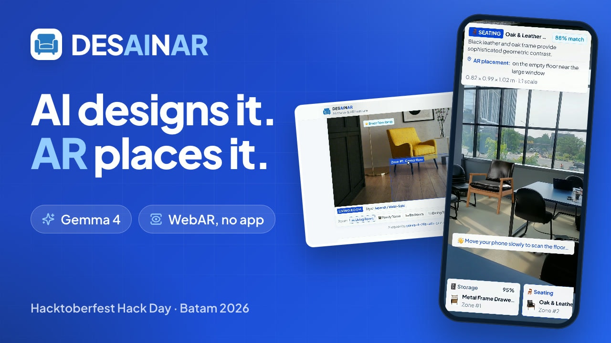

# DESAINAR



**Your AI Interior Design & AR Furniture Specialist.** Snap a photo of your room, and Gemma 4 will:

1. identify the room type and its scale,
2. map empty zones, light direction and wall planes right on top of the photo (the **Analysis** tab),
3. read the 60-30-10 colour palette and recommend a new wall paint,
4. pick furniture from a 3D catalogue that you can try in your real room at 1:1 scale through **WebAR**,
5. write a design concept prompt for the **After** image.

Built at Hacktoberfest Hack Day Batam x Batam Innovation Center (MLH), 31 October 2026.

## How it works

```
Browser (phone)
 ├─ photo compressed (≤1024 px) → POST /api/analyze
 │     └─ Vercel Function → Gemini API: Gemma 4 (gemma-4-26b-a4b-it / gemma-4-31b-it)
 │           └─ JSON validated: item_id must exist in the catalogue, coordinates & hex checked
 ├─ Analysis tab: Gemma's annotations drawn over the photo (% coordinates)
 ├─ AI Design tab: prompt from Gemma → Pollinations (browser first, then the /api/render proxy)
 │     no key: free "sana" model (alias DreamShaper 8 LCM) · with key: FLUX.1 [schnell]
 └─ AR: Google <model-viewer> (WebXR / Scene Viewer / Quick Look)
```

- **Instant** (`gemma-4-26b-a4b-it`, MoE with ~4B active parameters) is the default. **Deep** (`gemma-4-31b-it`, dense) gives a more thorough analysis and falls back to Instant automatically when the server is busy. Thinking is turned off in both modes to keep things fast.
- Each analysis makes two Gemma calls in parallel: one for space and colour analysis, one for furniture recommendations and the render prompt. Both answer in English, in JSON mode.
- The API key lives only on the server. This repo is public, and the key is never sent to the browser.
- The "Try the sample photo" button loads a saved Gemma result (plus a static render), so the demo still works when the network is unreliable.
- The UI follows the "Architectural Sapphire" design system: white surfaces, thin lines, sapphire blue accents and the Plus Jakarta Sans font.

## Running locally

```bash
npm install
cp .env.example .env.local   # set GEMINI_API_KEY from https://aistudio.google.com/apikey
npm run dev                  # http://localhost:5173 (+ /api/analyze via Vite middleware)
```

AR needs HTTPS. To test it on a phone, use the Vercel deploy URL.

**Deploy:** import the repo into Vercel (Vite preset), then set the `GEMINI_API_KEY` env variable.

**Optional:** set the `POLLINATIONS_KEY` env variable to a secret key (`sk_`) from [enter.pollinations.ai](https://enter.pollinations.ai). Without a key, the free Pollinations tier only allows 1 image per 45 seconds per IP. That is why renders are tried from the user's browser first, with the `/api/render` proxy as a fallback.

## Structure

| Path | Contents |
|------|----------|
| `server/analyze.js` | Gemma 4 prompts, Gemini API calls, JSON validation |
| `api/analyze.js` | Vercel Function wrapping `server/analyze.js` |
| `server/render.js`, `api/render.js` | Pollinations render proxy that only passes through real images |
| `src/data/catalog.js` | 3D furniture catalogue (Gemma may only pick ids from here) |
| `src/data/options.js` | Design styles, room types, Gemma engines |
| `src/components/` | UI: style picker, visual panel, colour insights, AR stage |
| `scripts/fetch-polyhaven.mjs` | Downloads Poly Haven models and packs them into `.glb` |

## Credits

- 3D models: [Poly Haven](https://polyhaven.com) (CC0)
- Sample photo: [Unsplash](https://unsplash.com) (Unsplash License)
- Concept renders: [Pollinations](https://pollinations.ai)
- AR: [Google &lt;model-viewer&gt;](https://modelviewer.dev)
- Room analysis: Gemma 4 via the Gemini API

## License

[MIT](LICENSE) © 2026 Ahmad Miftahul Zaki
